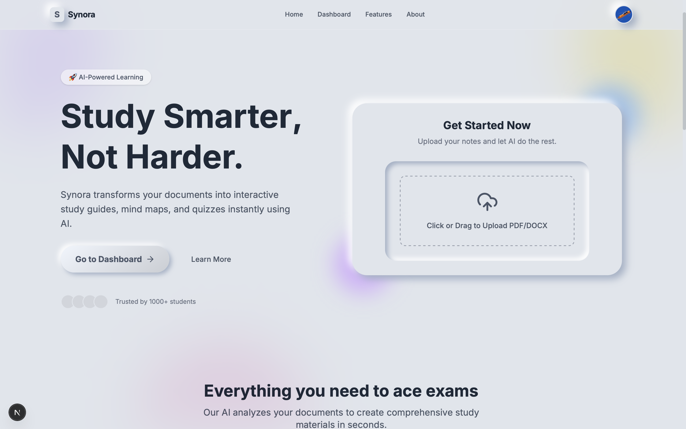
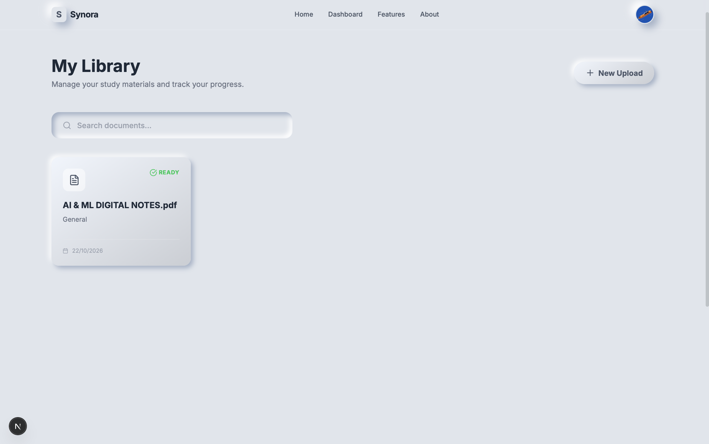
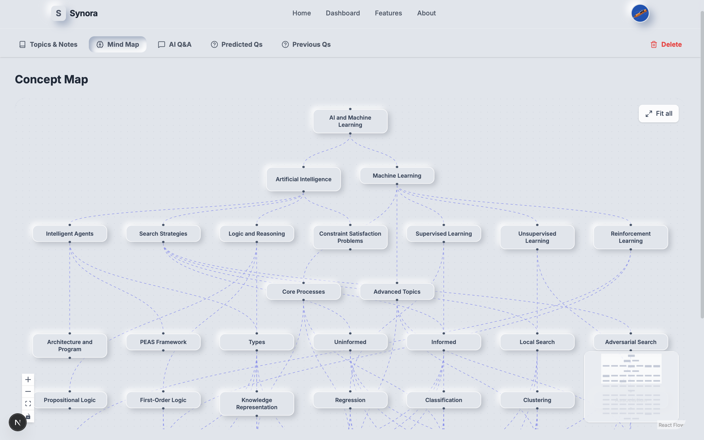
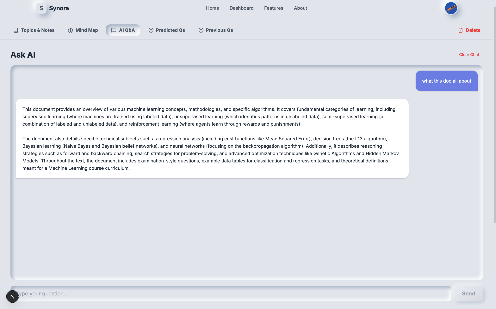
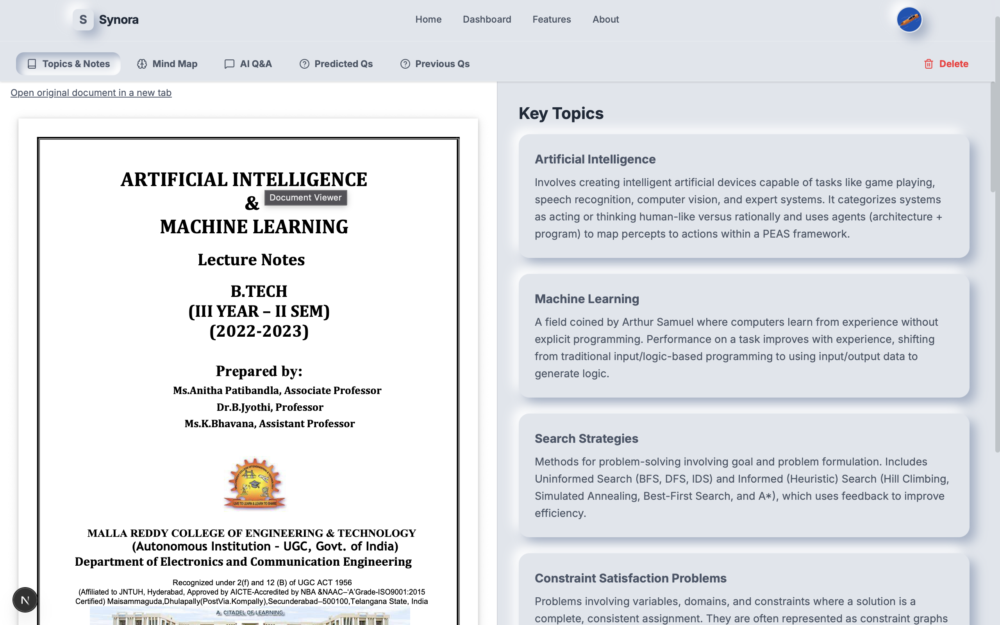
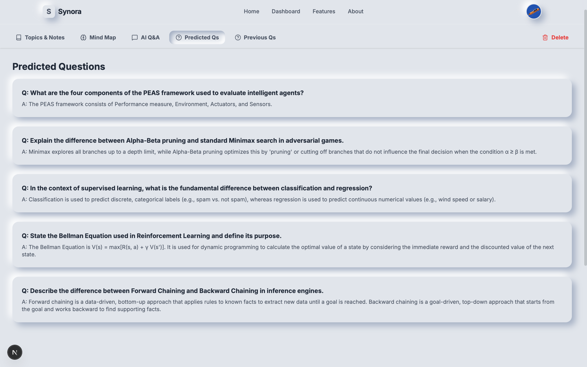

# Synora

Synora is an AI-powered study assistant that transforms PDF documents into interactive learning experiences. It generates dynamic mind maps, extracts key topics, and provides an intelligent Q&A chat interface to help students understand complex material faster.

## Visuals

### Homepage


### Dashboard


### Interactive Mind Map


### AI Q&A Interface


### Key Topics Extraction


### Predicted Questions


## Features

- **Interactive Mind Maps**: Visualizes concepts from your PDFs in a hierarchical tree structure using React Flow.
- **AI-Powered Q&A**: Chat with your documents. The system uses RAG (Retrieval-Augmented Generation) to provide accurate answers based *only* on the specific document's content.
- **Topic Extraction**: Automatically identifies and explains key topics.
- **Parallel Processing**: Optimized backend processes large PDFs quickly by running analysis and vector embedding tasks concurrently.

## Technology Stack

### Frontend
- **Framework**: Next.js 14 (App Router)
- **Language**: TypeScript
- **Styling**: Tailwind CSS
- **Visualization**: React Flow (for Mind Maps)

### Backend
- **Framework**: FastAPI (Python)
- **LLM**: Google Gemini (Flash 2.0 & Pro)
- **Vector DB**: Pinecone
- **Storage**: Google Cloud Storage (GCS)
- **Caching/Progress**: Redis
- **Orchestration**: LangGraph (for analysis workflows)

## Quick Start

### Large documents

PDF uploads retain every page. Text PDFs and DOCX files are extracted to disk;
scanned PDFs require OCR first. Document analysis summarizes every section and
combines those summaries when the text exceeds the analysis context budget.
Summaries are lossy; Q&A indexes the original extracted text in overlapping
chunks so it can retrieve details beyond the document overview.

Embedding requests use batches of up to 16 chunks, with two batches in flight.
Indexing runs alongside analysis, and topics become visible before the rest
finishes. The backend logs extraction, analysis, and indexing durations.

The default upload limit is **100 MB**, subject to file-storage provider limits.
It can be changed in the root `.env` with `MAX_UPLOAD_MB`. Other optional limits:

```env
DOCUMENT_CONCURRENCY=2
LLM_CONCURRENCY=4
EMBEDDING_CONCURRENCY=2
EMBEDDING_BATCH_SIZE=16
ANALYSIS_CONTEXT_CHARS=24000
```

These limits apply per backend process. Larger files still take proportionally
more time and API usage; provider quotas, disk space, and network bandwidth
remain limits. Background processing currently runs inside the API process:
restarting it can interrupt jobs, which are not automatically resumed. A durable
worker queue and resumable uploads are required before promising unattended
processing of very large files across restarts.

Local regression checks (provider requests are mocked):

```bash
cd backend
python -m unittest discover -s tests -v
```

### Document features and recovery

The backend detects the configured Pinecone index schema. Schema-based indexes
use the Documents API; integrated text embedding indexes use Pinecone's own
configured model. Legacy vector indexes continue to use vector upsert/query.
See the [Pinecone SDK migration guide](https://github.com/pinecone-io/python-sdk/blob/main/docs/migration/v10-migration.md).

Failed or incomplete documents show an error with **Retry processing**, which
reuses the stored original. Successful analysis remains available if indexing
fails. AI Q&A retrieves only the selected document's passages; empty retrieval
shows a retry message instead of generating an unsupported answer. **Previous
Qs** shows your saved questions and answers for this document; it is not a
database of historical examination papers. Delete removes the document's search
namespace, stored file, and related database rows, with cleanup errors reported.

### Run locally in VS Code

Open this folder in VS Code. Copy `.env.example` to `.env` and fill in the real
PostgreSQL, Gemini, Pinecone, UploadThing, and Google OAuth credentials. Keep
`.env` private. Configure the Google OAuth redirect URI as
`http://localhost:3000/api/auth/callback/google`.

For Docker Desktop, run `docker compose up --build` in the VS Code terminal.
The development Compose file uses the root `.env` for both services and starts
Redis. Open `http://localhost:3000`; the API is at `http://localhost:8000/docs`.
Before signing in for the first time, create the application tables:

```bash
docker compose exec backend prisma db push --skip-generate
```

For a native run, use `prisma db push` from `backend`. Review schema changes
before applying them to a database that contains data. If you signed in before
the tables existed, sign in again after this command succeeds.

For a native development run, install backend dependencies from
`backend/requirements.txt`, run `prisma generate`, and install frontend
dependencies with `npm ci` in `frontend`. Copy the root `.env` to
`backend/.env` and `frontend/.env.local`, or link those files to `../.env`.
Start Redis locally, then use separate terminals:

```bash
cd backend && REDIS_URL=redis://localhost:6379 uvicorn main:app --reload
cd frontend && API_URL=http://localhost:8000 npm run dev
```

The native run needs Python 3.12 and Node 20 or newer. The root `.env` defaults
to Docker service names for `REDIS_URL` and `API_URL`, so the overrides above
are required outside Docker.

### Using Docker Compose (Recommended)

The easiest way to run the entire stack (Frontend, Backend, Redis) is with Docker Compose.

```bash
docker-compose up --build
```

Access the app at `http://localhost:3000`.

### Manual Setup

Please refer to the specific README files for detailed setup instructions:

- [Backend README](./backend/README.md)
- [Frontend README](./frontend/README.md)
